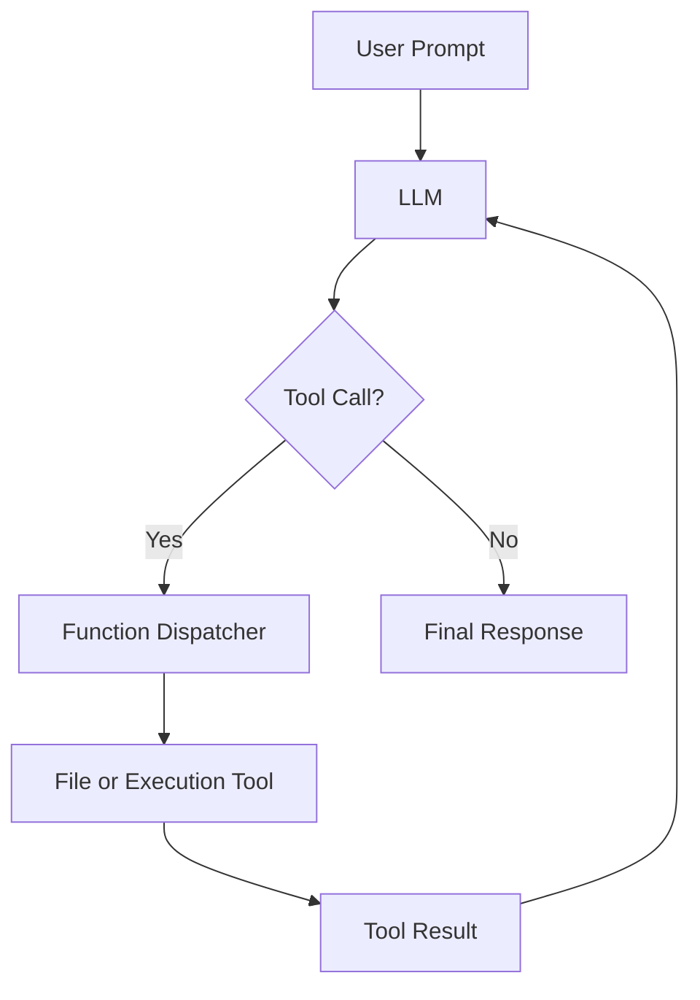

# LLM-Powered Coding Agent

A command-line AI coding agent built with Python and the OpenRouter API. The agent uses LLM function calling to inspect directories, read and modify source files, execute Python scripts, and solve coding tasks through iterative tool execution.

## Features

- LLM-powered coding assistance through natural-language prompts.
- Multi-step reasoning and iterative function calling.
- Directory inspection and file metadata retrieval.
- Source code reading, creation, and modification.
- Python script execution with optional command-line arguments.
- Structured JSON tool definitions and argument processing.
- Working-directory path validation.
- Execution timeouts and error handling.
- Verbose logging and token usage tracking.

## Tech Stack

- Python
- OpenRouter API
- OpenAI Python SDK
- Python-dotenv
- JSON-based function calling
- uv package manager

## Architecture

The agent receives a natural-language instruction and sends it to an LLM alongside a set of available tool definitions.

The model can request tool execution, receive the results, and continue processing the task until it produces a final response or reaches the iteration limit.



The agent supports up to 20 model interaction iterations per request.

## Available Tools

| Tool | Description |
| --- | --- |
| get_files_info | Lists files and directories with metadata. |
| get_file_content | Reads file contents with a configurable length limit. |
| write_file | Creates or overwrites files. |
| run_python_file | Executes Python scripts and captures their output. |

## Installation

### Prerequisites

- Python 3.10 or later
- uv
- An OpenRouter API key

### Clone the repository

```bash
git clone https://github.com/YaraObeid/ai-agent.git
cd ai-agent
```

### Install dependencies

```bash
uv sync
```

### Configure environment variables

Create a `.env` file in the project root:

```env
OPENROUTER_API_KEY=your_api_key_here
```

Never commit your API key to version control.

## Usage

Run the agent with a natural-language instruction:

```bash
uv run main.py "Explain how this calculator application works"
```

Enable verbose mode to inspect tool calls and token usage:

```bash
uv run main.py "Find potential bugs in the calculator application" --verbose
```

Other example prompts:

```bash
uv run main.py "List the files in the project"
```

```bash
uv run main.py "Locate the calculator evaluation logic and explain it"
```

```bash
uv run main.py "Run the calculator tests and investigate any failures"
```

## Project Structure

```text
ai-agent/
├── main.py
├── prompts.py
├── config.py
├── functions/
│   ├── get_files_info.py
│   ├── get_file_content.py
│   ├── write_file.py
│   └── run_python_file.py
├── calculator/
├── test_get_files_info.py
├── test_get_file_content.py
├── test_write_file.py
├── test_run_python_file.py
├── pyproject.toml
├── uv.lock
└── README.md
```

The included calculator application provides a demonstration workspace for testing the agent's coding and debugging capabilities.

## Testing

The repository includes individual test scripts for each tool.

```bash
uv run test_get_files_info.py
uv run test_get_file_content.py
uv run test_write_file.py
uv run test_run_python_file.py
```

Run file-modification tests in a disposable workspace.

## Execution Controls and Limitations

- Tool paths are checked against the configured working directory.
- The working directory is assigned by the application rather than the LLM.
- Python subprocess execution has a 30-second timeout.
- File reading is subject to a configurable character limit.
- Agent execution is limited to 20 iterations.

These controls are not a complete security sandbox. Executed Python code inherits the permissions of the running process. Use the agent only with trusted local workspaces or inside an isolated environment.

The current workspace is configured as `./calculator`.

## Purpose

This project explores the fundamentals of agentic AI, including LLM orchestration, structured tool calling, automated code interaction, execution-result feedback, and controlled tool execution.

## Author

Yara Obaid

Computer Engineering -- Artificial Intelligence

[GitHub](https://github.com/YaraObeid)
